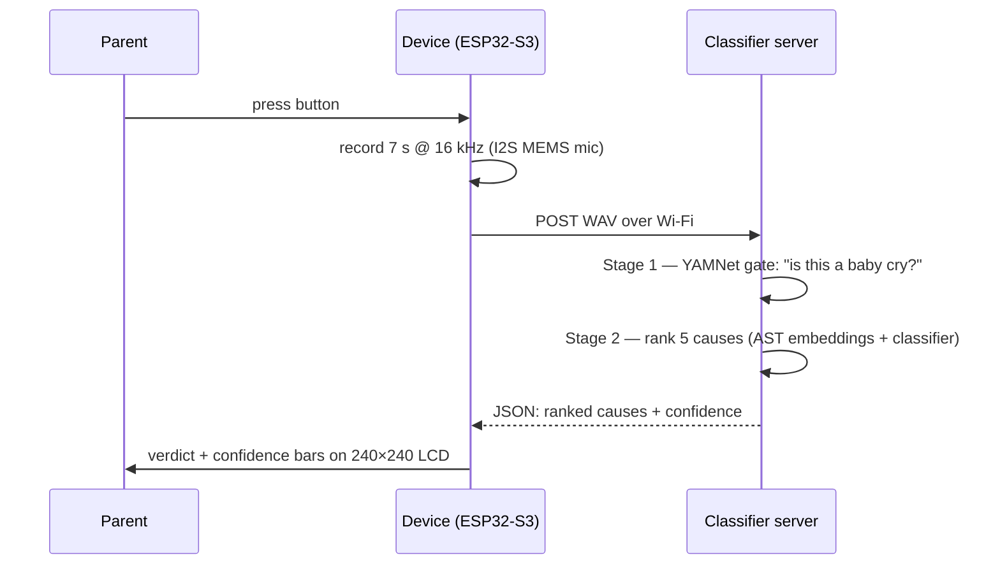

<div align="center">

# 👶 crybaby

**Your baby is telling you something. crybaby translates.**

A push-button baby-cry analyzer reflashed onto a $15 AI toy — press the button, get the likely reason on screen.

Press a button when your baby cries → the device records 7 seconds → a two-stage
audio-ML pipeline tells you the most likely reason — *hungry, tired, uncomfortable,
belly pain/gas, or needs burping* — right on its little screen.

[](firmware/)
[](server/)
[](firmware/main/ui.c)
[](LICENSE)

</div>

---

## The system at a glance

```mermaid
flowchart LR
    B(("👶 baby")) -->|cry| MIC
    P(("🧑 parent")) -->|push-to-talk| MIC

    subgraph DEV["📟 device · ESP32-S3"]
        MIC["🎙 I2S mic<br/>16 kHz → PSRAM"] --> FW["⚙️ firmware<br/>state loop"]
        FW --> LCD["👀 240×240 LCD<br/>emotive eyes + verdict"]
        FW --> SPK["🔊 speaker"]
    end

    subgraph CLS["🧠 classifier · :8977"]
        GATE["YAMNet cry gate"] --> AST["AST embeddings"] --> HEAD["logreg<br/>rank 5 causes"]
        HEAD -.-> GEM["✨ Gemini second opinion<br/>(optional)"]
    end

    subgraph VB["🗣 voicebot · :8978"]
        STT["faster-whisper STT"] --> LLM["LLM<br/>answers from the docs"] --> TTS["Piper TTS"]
    end

    FW ==>|"WAV · /analyze"| GATE
    HEAD ==>|"ranked causes JSON"| FW
    FW ==>|"speech WAV · /talk"| STT
    TTS ==>|"reply WAV + transcript"| FW

    style DEV fill:#0d1b2e,stroke:#4da3ff
    style CLS fill:#0d2318,stroke:#3ddc84
    style VB  fill:#1a1030,stroke:#b388ff
```



▶ **Animated version:** open [`dataflow.html`](dataflow.html) locally in a browser — live data
pulses along every edge. Each component folder has its own pair too:
[`firmware/dataflow.html`](firmware/dataflow.html) ·
[`server/dataflow.html`](server/dataflow.html) ·
[`server-voicebot/dataflow.html`](server-voicebot/dataflow.html).

## How it works



- **Stage 1 (cry gate)** — [YAMNet](https://tfhub.dev/google/yamnet/1) rejects TV noise,
  speech, and silence so you never get a confident-sounding answer to a non-cry.
- **Stage 2 (cause ranking)** — logistic regression over
  [AST](https://huggingface.co/MIT/ast-finetuned-audioset-10-10-0.4593) embeddings
  (winner of a 10-encoder bake-off, [docs/ACCURACY-V2.md](docs/ACCURACY-V2.md)), trained
  with fold-safe augmentation on the
  [donateacry corpus](https://github.com/gveres/donateacry-corpus) (5 labeled cry causes).
  `train.py` still builds a lighter YAMNet-only bundle for boxes without PyTorch.
- Optional **LLM second opinion** — set `GEMINI_API_KEY` and each response also carries an
  independent [Gemini audio-understanding](https://ai.google.dev/gemini-api/docs/interactions/audio) verdict.

## Talk to it

Hold the right-hand button and ask the device a question about itself — "what sample rate
does your mic use?", "how accurate are you really?" — and it answers out loud. Speech goes
to a second service on your LAN ([`server-voicebot/`](server-voicebot/)) that transcribes
with faster-whisper, answers from this repo's own docs plus a live read of the deployed
classifier, and speaks back through Piper. Nothing leaves your network except the LLM call.

| Button | Action | Function |
|---|---|---|
| Middle | tap | **analyze** — record 7 s, classify the cry |
| Right | hold | **push-to-talk** — ask the device a question |
| Left | tap | volume down |
| Left (hold) + right (tap) | chord | volume up |

Middle-button-held-while-tapping-power is also how you enter USB download mode for
flashing — see [docs/FLASHING.md](docs/FLASHING.md).

## The hardware

Built for the **Zhengchen ZC-1.54TFT-WiFi** — a ubiquitous ~$15 "xiaozhi" AI-chatbot toy
(ESP32-S3, 1.54" 240×240 LCD, I2S mic, speaker, battery, three buttons), fully reflashed.
Any ESP32-S3 board with an I2S mic and SPI LCD works with pin changes in
[`firmware/main/board.h`](firmware/main/board.h). Full teardown: [docs/HARDWARE.md](docs/HARDWARE.md).

## Quick start

### 1. Classifier server (any Linux box on your LAN)

```bash
rsync -a server/ yourserver:crybaby-server/
ssh yourserver
cd crybaby-server
python3 -m venv venv && venv/bin/pip install -r requirements.txt
venv/bin/python train.py            # clones the corpus, trains, prints honest CV metrics
venv/bin/uvicorn app:app --host 0.0.0.0 --port 8977
# open firewall: e.g. sudo ufw allow from 192.168.0.0/16 to any port 8977 proto tcp
curl http://yourserver:8977/health  # {"ok": true, "model_loaded": true}
```

### 2. Firmware

```bash
cd firmware
cp main/secrets.h.example main/secrets.h   # your Wi-Fi + server URL (gitignored)
idf.py set-target esp32s3 && idf.py build
idf.py -p /dev/cu.usbserial-XXXX flash monitor
```

**Device won't enter download mode?** These toys hide the BOOT strap on the main/middle
button: *hold middle → tap power → keep holding 2 s → release*. Flaky USB link? See the
battle-tested procedure in [docs/FLASHING.md](docs/FLASHING.md).

## Honest accuracy ⚠️

Read this before trusting the gadget: the only public training data
([donateacry](https://github.com/gveres/donateacry-corpus)) is small (457 clips) and
heavily skewed (84 % "hungry"). Stratified 5-fold CV of the deployed model
(AST + logistic regression + fold-safe augmentation, macro-F1 0.38 — up from the
0.29 YAMNet baseline after a 10-encoder bake-off):

| Class | F1 | Training clips |
|---|---|---|
| hungry | **0.90** | 382 |
| belly pain | 0.35 | 16 |
| discomfort | 0.30 | 27 |
| tired | 0.21 | 24 |
| burping | 0.17 | 8 |

Papers claiming 90 %+ on this dataset are typically inflated by augmentation leakage.
Treat the output as a **ranked suggestion, never a diagnosis** — and the cry-gate ensures
at least you're only ever ranking actual cries. The minority classes are data-starved;
real parent-confirmed labels (feedback flow, roadmap) are the only fix left.

## Repo map

| Path | What |
|---|---|
| [`firmware/`](firmware/) | ESP-IDF 5.5 app — I2S capture + playback, Wi-Fi POST, LVGL UI |
| [`server/`](server/) | FastAPI classifier — YAMNet gate + trained model + optional Gemini |
| [`server-voicebot/`](server-voicebot/) | FastAPI voicebot — push-to-talk STT → LLM → TTS |
| [`docs/HARDWARE.md`](docs/HARDWARE.md) | Device teardown: chip, pin map, flash layout |
| [`docs/FLASHING.md`](docs/FLASHING.md) | Download-mode entry + flashing over unstable USB |
| [`docs/RESEARCH.md`](docs/RESEARCH.md) | Prior art: ChatterBaby, Dunstan, datasets, model benchmarks |

## Roadmap

- [x] Minority-class accuracy: encoder bake-off + fold-safe augmentation (AST deployed, macro-F1 0.29 → 0.38)
- [ ] "Was this right?" feedback flow → parent-confirmed labels ([docs/FEEDBACK-FLOW.md](docs/FEEDBACK-FLOW.md), designed)
- [ ] Gemini second-opinion fusion on the result screen
- [ ] History screen (last N analyses) using the spare flash partition
- [ ] On-device TinyML fallback for Wi-Fi-less operation (ESP32-S3 has the headroom)
- [x] Speaker output — boot chime and spoken voicebot replies
- [ ] Speak the cry verdict aloud ("likely hungry, 72 percent")
- [ ] Stream TTS sentence-by-sentence; barge-in to interrupt a reply

## Acknowledgments

- [xiaozhi-esp32](https://github.com/78/xiaozhi-esp32) — board definitions for the donor device
- [donateacry-corpus](https://github.com/gveres/donateacry-corpus) — the dataset making any of this possible
- [YAMNet](https://tfhub.dev/google/yamnet/1) / AudioSet — the audio backbone
- UCLA's [ChatterBaby](https://chatterbaby.org/) — prior art proving the concept

## License

[MIT](LICENSE) — built with care, shipped with honesty. Not a medical device.
