# Firmware (ESP-IDF 5.5, LVGL 9)

Complete reflash for the Zhengchen ZC-1.54TFT-WiFi toy: one main loop drives
record → POST → show, no task zoo. Pin map lives in [`main/board.h`](main/board.h);
Wi-Fi credentials + server URLs go in `main/secrets.h` (gitignored, see
[`main/secrets.h.example`](main/secrets.h.example)). Build/flash SOP:
[`../docs/FLASHING.md`](../docs/FLASHING.md).

## Data flow

```mermaid
flowchart LR
    BTN["🔘 buttons · GPIO<br/>middle analyze · right talk · left vol"] --> MAIN

    subgraph CORE["main.c · state loop"]
        MAIN["idle → record → send → show"]
    end

    MAIN -->|start rec| MIC["🎙 mic.c<br/>I2S DMA → PSRAM"]
    MIC -->|PCM| MAIN
    MAIN <-->|"WAV ⇄ JSON"| NET["📡 net.c<br/>POST /analyze · /talk"]
    NET -.->|Wi-Fi| LAN(("🌐 LAN services<br/>:8977 · :8978"))
    MAIN --> UI["ui.c · LVGL screens<br/>verdict bars · hints"]
    UI --> EYES["👀 eyes.c<br/>idle · listening · thinking · sad"]
    UI --> DISP["display.c<br/>ST7789 SPI · 240×240"]
    EYES --> DISP
    MAIN -->|reply WAV| SPK["🔊 speaker.c · I2S out"]

    style CORE fill:#0d1b2e,stroke:#4da3ff
    style EYES fill:#0d2328,stroke:#40e0d0
```

▶ **Animated version:** open [`dataflow.html`](dataflow.html) locally in a browser.

## The eyes

`eyes.c` gives the device a Wall-E-style face: a self-animating pair of eyes with
blinks, gaze saccades, and per-eye tilt/skew poses. Each UI state picks a mood —
calm wandering when idle (with curious side-glances and the odd surprise pop),
wide and locked-on while listening, squinted brow-raise flicks while
thinking/analyzing, drooped and downcast on errors. All animation runs inside the
LVGL task; the instance frees itself when its screen is replaced.
