# Classifier service (any Linux box on your LAN, port 8977)

Two-stage pipeline: YAMNet cry-gate → classifier over the embeddings named by the
model bundle, trained on donateacry (5 classes). `train.py` builds a YAMNet +
logistic-regression bundle with the base requirements; the deployed winner is an
AST + logreg bundle from `benchmark.py --fit`, which needs the benchmark extras
(torch + transformers) installed to *serve* too — `app.py` loads the bundle's
encoder at startup. Optional Gemini second opinion via `GEMINI_API_KEY` in
`~/crybaby-server/.env`.

## Data flow

```mermaid
flowchart LR
    subgraph SERVE["POST /analyze · serving path"]
        IN["📥 WAV in"] --> PRE["audio_pipeline<br/>decode · mono · resample"]
        PRE --> GATE{"🚧 YAMNet gate<br/>is it a cry?"}
        GATE -->|"cry ✗"| NO["🙅 is_cry: false<br/>honest no"]
        GATE -->|"cry ✓"| ENC["AST encoder<br/>mean-pooled embeddings"]
        ENC --> HEAD["logreg head<br/>rank 5 causes"]
        HEAD -.-> GEM["✨ Gemini second opinion<br/>optional"]
        HEAD --> OUT["📤 JSON<br/>ranked causes + probs"]
    end

    subgraph TRAIN["offline · training path"]
        CORPUS["🗂 donateacry corpus<br/>457 clips · 5 labels"] --> BENCH["benchmark.py --fit<br/>bake-off · fold-safe augment"]
        BENCH --> BUNDLE["📦 model.joblib<br/>encoder + head + labels"]
    end

    BUNDLE -.->|loaded at startup| ENC

    style SERVE fill:#0d2318,stroke:#3ddc84
    style TRAIN fill:#231f0d,stroke:#ffd60a
```



▶ **Animated version:** open [`dataflow.html`](dataflow.html) locally in a browser.

## Deploy

```bash
rsync -a server/ yourserver:crybaby-server/
ssh yourserver 'cd crybaby-server && python3 -m venv venv && venv/bin/pip install -r requirements.txt'
ssh yourserver 'cd crybaby-server && venv/bin/python train.py'   # clones corpus, ~5 min
ssh yourserver 'mkdir -p .config/systemd/user && cp crybaby-server/systemd/crybaby.service .config/systemd/user/ && systemctl --user daemon-reload && systemctl --user enable --now crybaby'
```

## Accuracy bake-off (optional, offline)

`benchmark.py` runs the docs/ACCURACY-V2.md harness: encoder x head x pooling
(clip-mean vs frame-voting) x fold-safe augmentation, 5-fold CV split at clip
level, one per-class-F1 table. Embeddings are cached, so re-runs are cheap.

```bash
venv/bin/pip install -r requirements-benchmark.txt --extra-index-url https://download.pytorch.org/whl/cpu
venv/bin/python benchmark.py --list-encoders   # what can run with current deps
venv/bin/python benchmark.py                   # full sweep, overnight on CPU
```

Deploy a winner (fits one config on ALL data, saves a serving bundle):

```bash
venv/bin/python benchmark.py --encoders ast --heads logreg --pooling mean \
    --augment on --fit model.joblib
systemctl --user restart crybaby
curl -s localhost:8977/health    # "encoder" shows what the bundle uses
```

## Test

```bash
curl -s http://your-server-ip:8977/health
curl -s --data-binary @cry.wav -H 'Content-Type: audio/wav' http://your-server-ip:8977/analyze
```
